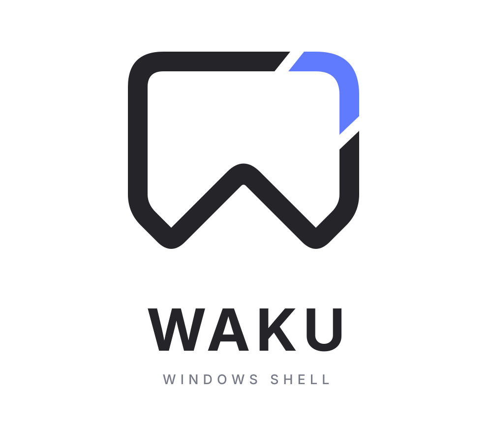

<p align="center">
  <picture>
    <source media="(prefers-color-scheme: dark)" srcset="docs/assets/waku-logo-dark.svg">
    
  </picture>
</p>

# waku

waku (枠, "frame", say "wah-koo") is a top bar for Windows, written in C++20 and Qt 6.10
(Qt Quick) and configured in QML. The name is the Japanese word for the frame around a window
(Dutch: kozijn), and the frame of your desktop is where the bar lives.

Built-in widgets cover the clock, workspaces (Windows virtual desktops), media, volume, Bluetooth,
Wi-Fi, battery, CPU, memory, the tray, the taskbar, notifications, GitHub, wallpapers and a control
center. You can copy any of them into your config and change it.

## Install

Download the MSIX for your processor (`waku-x64.msix` or `waku-arm64.msix`) from the
[latest release](https://github.com/JanDeDobbeleer/waku/releases/latest) and open it.
Then start `waku` from the Start menu or a terminal.
The full guide is [docs/install.md](docs/install.md).

## Customise

waku reads its config from a folder, the config home: `--config-home <dir>`, then the
`WAKU_CONFIG_HOME` variable, then `%USERPROFILE%\.config\waku`. Without a `shell.qml` there, you get
a built-in bar.

`shell.qml` says which bars to show and which widgets go where; `theme.qml` sets the look. Save
either file and the bar reloads. Run `wakuc config init` to write a starter `shell.qml` into the
config home; [examples/config](examples/config) has a fuller sample.

```qml
import waku
import waku.widgets

ShellRoot {
    Panel {
        edge: Panel.Top
        thickness: 40
        content: PanelLayout {
            start: [ Clock {} ]
            end: [ Volume {}, Battery {} ]
        }
    }
}
```

`wakuc` controls the running bar (`reload`, `status`, `quit` and more). See
[src/app/README.md](src/app/README.md) for its commands.

## Shells

waku is Quickshell-compatible, so shells written for Quickshell run with few changes. Ready-made
shells ported to Windows (Caelestia, Noctalia, Omarchy) are in
[waku-ports](https://github.com/JanDeDobbeleer/waku-ports). Copy one into your config home. What
differs from Quickshell is in [docs/shells.md](docs/shells.md).

### Build your own shell with an AI agent

The repository ships a skill, `waku-shell`, that helps an agent create, port or restyle a shell from
a screenshot, a Reddit post (such as an r/unixporn URL) or an existing Quickshell shell. It works
from a measured spec, keeps only elements that have a real backend on Windows, drops and reports
the rest, and checks each shell before it hands it over. Source: [skills/waku-shell](skills/waku-shell).

Claude Code:

```
claude plugin marketplace add JanDeDobbeleer/waku
claude plugin install waku-shell@waku
```

Then ask for what you want, for example "recreate the look of this screenshot as a waku shell", or
run `/waku-shell:waku-shell`. In Claude Code 2.1.275 or later,
`/plugin install waku-shell --marketplace JanDeDobbeleer/waku` does both steps.

Other agents (Codex, Cursor and others) can install the skill folder with the
[skills CLI](https://vercel.com/docs/agent-resources/skills):

```
npx skills add JanDeDobbeleer/waku --skill waku-shell
```

or copy `skills/waku-shell` into your agent's skills folder.


## Optional companions

waku runs on its own. One thing may need a helper:

- **Keybinds.** waku does not bind keys for a shell's shortcuts by default. Bind a key to
  `wakuc shortcut <name>` in [whkd](https://github.com/LGUG2234/whkd) or
  [AutoHotkey](https://www.autohotkey.com/), for example `win + space : wakuc shortcut launcher`.
  A `GlobalShortcut` that sets `keys` registers its own key. See
  [docs/shells.md](docs/shells.md#global-shortcuts-without-keys).

## Build from source

Install Visual Studio Build Tools, Qt 6.10 and vcpkg, then:

```powershell
cmake --preset arm64-release
cmake --build --preset arm64-release
```

Use `x64-release` on an x64 PC. Prerequisites, presets and the flags of `waku` are in
[docs/building.md](docs/building.md).

## Documentation

| Document | What it covers |
| --- | --- |
| [docs/install.md](docs/install.md) | Install from the MSIX, first run, updates, troubleshooting |
| [docs/shells.md](docs/shells.md) | Notes for shell authors: what differs from Quickshell |
| [docs/building.md](docs/building.md) | Prerequisites, presets, deploy, command-line flags |
| [docs/architecture.md](docs/architecture.md) | Units and layering, threads, singletons, error policy |
| [src/app/README.md](src/app/README.md) | Running `waku` and `wakuc`, config home, QML modules |
| [SECURITY.md](SECURITY.md) | Threat model and how to report a problem |

## Licence and credits

waku is released under the MIT licence ([LICENSE](LICENSE)). It began as a C++ port of
[YASB](https://github.com/amnweb/yasb) and still uses what YASB found out about Windows (tray
messages, window tracking, notifications). [THIRD_PARTY_NOTICES.md](THIRD_PARTY_NOTICES.md) holds the
notices that must travel with any copy.
