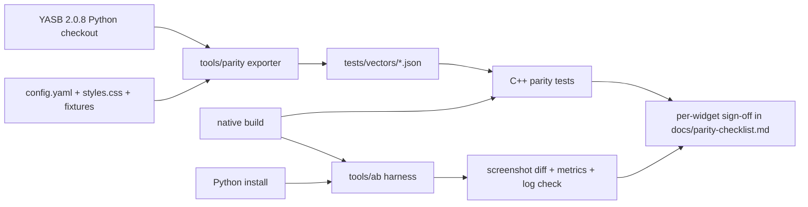
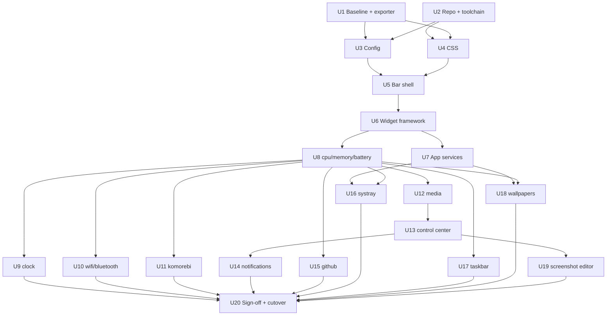

# feat: Port YASB to C++/Qt6 for the widgets in the current config

**Target repo:** a new repository (working name `yasb-native`, see Open Questions). Paths without a prefix are relative to that repository's root. Paths prefixed `yasb:` point into this repository (`JanDeDobbeleer/yasb`, branch `local/build`, version 2.0.8), which stays the behavioral reference throughout. This file moves to the new repository's `docs/plans/` once it exists.

## Overview

Rebuild YASB as a native C++20/Qt 6.10 application, limited to what the current `config.yaml` uses: one adaptive bar, 15 widgets, hot reload, widget hotkeys, the YASB tray icon and the CLI. The existing `config.yaml` and `styles.css` must load unchanged. Every widget is validated against the Python build through automated parity vectors and an A/B harness that swaps the two builds on the same machine.

---

## Problem Frame

YASB is about 117k lines of Python on PyQt6. The goal is a faster, lighter bar without losing behavior the user relies on. A full port of all 59 widgets is out of proportion, so the port covers exactly the widgets in use, and the Python build stays installed until the native build passes parity. Performance gains are a hypothesis: the plan measures them against a recorded baseline instead of assuming them.

The machine is a Surface Pro 11 (Snapdragon X, **ARM64**, 3840x2560 at 150%), running komorebi + whkd, so ARM64 is the primary target and x64 is secondary.

---

## Requirements Trace

- R1. Load the existing `config.yaml` unchanged, with the same validation outcome (unknown keys rejected, same defaults, invalid widget dropped and logged).
- R2. Load the existing `styles.css` unchanged and render the bar visually equivalent to the Python build, including the adaptive island shape and the CSS features the stylesheet uses (transitions on `width`, `padding`, `background-color`, `opacity`; `:clicked`; `opacity`; `cursor`; 242 `var()` references; 5 `-qproperty-*` values).
- R3. Port these 15 widgets with equivalent labels, CSS classes, callbacks and popups: control_center, komorebi_workspaces, komorebi_active_layout, taskbar, clock, media, systray, wallpapers, github, notifications, cpu, memory, bluetooth, wifi, battery.
- R4. App features: config/stylesheet hot reload, widget keybindings (`alt+e` with `screen: cursor`), the YASB tray icon menu, and CLI commands (`stop`, `reload`, `show-bar`, `hide-bar`, `toggle-bar`, `log`).
- R5. Share user state with the Python build: config dir (`YASB_CONFIG_HOME` or `~/.config/yasb`), `alarms.json`, and `%LOCALAPPDATA%\YASB` files (GitHub token, tray pins).
- R6. Behavior is validated per widget before cutover: automated parity vectors pass, A/B screenshots match within tolerance, and the manual popup checklist is signed off.
- R7. Record startup time, private working set, idle CPU and wakeups for both builds; the native build must not be worse on any metric before cutover.
- R8. ARM64 and x64 builds; the tray hook DLL ships for both.

---

## Scope Boundaries

- No other widgets, no GlazeWM widgets, no second bar, and no bar options the config does not set beyond their defaults.
- No update checker, Themes Manager (`yasb_themes.exe`), cloud backup (`yasb_cloud.exe`), first-run wizard or modal config error dialogs. Errors are logged instead (user decision).
- yasbc client-only commands (autostart, update, channel switching, crash dumps) are out of scope; the native app serves the pipe protocol only.
- No changes to `JanDeDobbeleer/yasb` beyond optional, separately proposed fixes found during parity work.
- No MSI installer; the deliverable is a portable `dist` folder.

### Deferred to Follow-Up Work

- Upstreaming or open-sourcing the native build: decide after cutover.
- MSI packaging and an update channel: after the native build replaces the Python install.

---

## Context & Research

### Relevant Code and Patterns

- App lifecycle: `yasb:src/main.py`, `yasb:src/core/bar_manager.py` (screen resolution, widget build, listener threads, reload = process restart), `yasb:src/core/utils/controller.py`.
- Bar and adaptive islands: `yasb:src/core/bar.py`, `yasb:src/core/bar_style.py` (`AdaptiveBarFrame` properties `railheight`, `islandradius`, `grouppadding`, `islands`, `edgeradius`, `borderwidth`, `bordercolor`), `yasb:src/core/bar_helper.py` (app bar, `.dark` theme class, fade-in).
- Widget base: `yasb:src/core/widgets/base.py` (`.widget` > `.widget-container` > `label`/`label alt`/span-class QLabels; string callbacks with quoted args; hotkey routing by widget name and screen).
- Popups and blur: `yasb:src/core/utils/utilities.py` (`PopupWidget`), `yasb:src/core/utils/stat_popup.py`, `yasb:src/core/utils/win32/backdrop.py`.
- Config and CSS: `yasb:src/core/config.py`, `yasb:src/core/validation/`, `yasb:schema.json` (344 defs, `additionalProperties: false`, defaults), `yasb:src/core/utils/css_processor.py`; transitions come from the external `qt-css-engine` package (not vendored).
- Paths: `yasb:src/settings.py` (`DEFAULT_CONFIG_DIRECTORY`, `APP_ID`), `yasb:src/core/utils/system.py` (`app_data_path` = `%LOCALAPPDATA%\YASB`).
- Hotkeys, app bar, single instance, CLI: `yasb:src/core/utils/win32/hotkeys.py`, `yasb:src/core/utils/win32/app_bar.py`, `yasb:src/core/utils/single_instance.py`, `yasb:src/core/cli/server.py`, `yasb:src/cli.py`.
- Per-widget sources and native APIs: see the table in High-Level Technical Design.
- Existing C++: `yasb:src/core/widgets/services/systray/hook/` (`trayhook.cpp`, CMake with static CRT, `/guard:cf`, ARM64 suffix), built in CI by `yasb:.github/workflows/build-trayhook.yml`.

### Tests That Serve as Specifications

- `yasb:tests/bar/test_adaptive_bar.py`: island merge, exclusion split, edge curves, snapping.
- `yasb:tests/widgets/test_wifi.py`: Wi-Fi/Ethernet/VPN label rules.
- `yasb:tests/widgets/test_systray_hook.py`: pipe reading, reconnect, shutdown drain.
- `yasb:tests/widgets/test_notifications.py`, `yasb:tests/widgets/test_taskbar_animation.py`, `yasb:tests/bar/test_bar.py`.
- `yasb:tests/win32/*`: MSVC probes that check ctypes structs against the SDK, a ready ABI reference.
- No tests exist for clock, media, cpu, memory, battery, bluetooth, github, wallpapers, control center or komorebi; parity vectors fill that gap.

### Institutional Learnings

- No `docs/solutions/` in this repository.
- From prior work on this machine: transient "mapping values are not allowed here" errors come from the watcher reading half-written saves; only the last reload event counts. Qt drops invalid QSS silently, so visual checks are mandatory. Segoe Fluent Icons and the Nerd Font collide in the Private Use Area (e.g. U+EEA1, used by the cpu label).

---

## Key Technical Decisions

- **Qt 6.10.x, matching PyQt6 6.10.2.** Same QSS parser and style engine, so `styles.css` renders the same way. Qt comes from the official MSVC ARM64/x64 builds (aqtinstall in CI); other libraries come from a vcpkg manifest.
- **C++20, CMake presets, MSVC, wil for Win32/COM handles, C++/WinRT for WinRT.** The WinRT surface (media, Wi-Fi, Bluetooth, notifications, display) maps directly to C++/WinRT projections; wil removes manual handle cleanup.
- **Validate in two stages against `schema.json`, after a ported deprecation pass, then prove it with normalized-config parity.** `schema.json` encodes keys, types, defaults and `additionalProperties: false`, but it types `widgets` as one union of all entries. Validating the whole document would reject everything for one bad widget. So the root and bars are validated with `widgets` treated as opaque, and each placed widget is validated on its own against the `$defs/<X>Entry` its `type` selects. Before validation, a port of `CustomBaseModel.handle_deprecated_fields` removes or renames deprecated keys with a warning, as Python does. Remaining differences are caught by comparing against Python's normalized output.
- **The native executable is `yasb.exe` from cutover onward.** `yasbc.exe` checks for a process named `yasb.exe` before it sends commands, and `yasbc start` launches `yasb.exe`. Until cutover the native build is `yasb-native.exe`. The A/B harness always identifies processes by full path or PID, never by name.
- **Python is the oracle.** A Python exporter in the new repo imports a pinned YASB checkout and writes JSON vectors (normalized config, processed CSS, rendered label parts with CSS classes, adaptive island geometry). C++ tests replay them. This turns "same behavior" into failing tests instead of opinions.
- **Same reload model as Python.** Config change restarts the process; stylesheet change re-applies live. Matching it keeps A/B results comparable.
- **Implement only the CSS engine features the stylesheet uses**, and log every unsupported construct once at load. Silent loss is the failure mode to avoid, since Qt ignores unknown QSS.
- **Coexistence by isolation, A/B by mutual exclusion.** The native build uses its own app mutex, command and log pipe names, tray-hook watchdog mutex, AUMID and log file (`yasb-native.log`), and shares config and data files. Both builds reserve the same app bar space and only one process can host the tray hook, so the A/B harness never runs both at once. At cutover the exe name, mutex and both pipes (`yasb_pipe_cli`, `yasb_pipe_log`) switch to the Python names so the existing `yasbc.exe` keeps working.
- **Reuse the tray hook DLL source.** Copy `trayhook.cpp`, make the pipe name **and** the watchdog mutex name (`Global\YASBTrayHookAlive` in Python) compile definitions, and build both architectures in the new repo's CI.
- **QImage replaces PIL; a CPython-compatible strftime wrapper replaces Python strftime.** CPython's `datetime.strftime` expands `%f`, `%z`, `%Z` and `%:z` itself, then calls CRT `wcsftime` with the invalid-parameter handler suppressed, and a bad directive raises `ValueError`, which the clock shows as raw text. The port does the same pre-expansion and installs a scoped invalid-parameter handler, so an invalid format never ends the process.
- **Order widgets from low to high native risk.** Simple polled widgets prove the framework before the large, undocumented-API widgets (taskbar, systray, wallpapers, notifications).

---

## Open Questions

### Resolved During Planning

- Where does the port live? A new repository (user decision).
- Config compatibility? Both `config.yaml` and `styles.css` load unchanged (user decision).
- Which app features? Hot reload, hotkeys, tray icon, CLI (user decision). Update check and error dialogs are excluded.
- Which CSS engine features are needed? Only `transition` (width, padding, background-color, opacity), `:clicked`, `opacity` and `cursor` (counted in the current `styles.css`).
- Can both builds run at once? No. Shared app bar space and the single tray hook host rule it out; A/B swaps them.

### Deferred to Implementation

- Repository name and visibility: needed before U2. Hosted `windows-11-arm` runners have been limited to public repositories, so a private repo may need a self-hosted ARM64 runner (the Surface) for the primary target.
- Which `qt-css-engine` commit is the reference: pin it in U1, since the dependency tracks the `dev` branch.
- License of `qt-css-engine`: confirm before using it as a behavioral reference for the transition engine.
- Whether `schema.json` on `local/build` includes the VPN-aware Wi-Fi fields: regenerate it from the local models in U1 if not.
- How `:clicked` timing and transition interpolation behave exactly: measure against the Python build during U4.
- The screenshot quick action's editor (2.6k lines): ported last (U19); its exact feature set is confirmed against the Python UI then.

---

## Output Structure

    yasb-native/
      CMakeLists.txt, CMakePresets.json, vcpkg.json
      app/                 entry point, single instance, tray icon, CLI server, hot reload, hotkeys
      core/
        config/            YAML load, env expansion, schema validation, typed options
        css/               preprocessor, transition engine subset
        bar/               bar window, app bar, adaptive frame, theme class
        widgets/           widget base, label formatter, popups, backdrop, event bus
      platform/            Win32/COM/WinRT services (pdh, battery, wlan, bluetooth, media, audio, ...)
      widgets/             one folder per ported widget
      hook/                trayhook.cpp copy, CMake for x64/ARM64 DLLs
      schema/              pinned schema.json
      tests/               C++ unit and parity tests, vectors/
      tools/parity/        Python vector exporter (runs against a YASB checkout)
      tools/ab/            PowerShell A/B harness and metrics capture
      docs/parity-checklist.md, docs/baseline.md

---

## High-Level Technical Design

> *This illustrates the intended approach and is directional guidance for review, not implementation specification. The implementing agent should treat it as context, not code to reproduce.*

### Validation loop

### Widget port map

| Widget | Python source (`yasb:src/core/...`) | Native APIs the port needs | Risk |
|---|---|---|---|
| cpu, memory | `widgets/yasb/{cpu,memory}.py`, `services/{cpu,memory}` | PDH, psapi, `GlobalMemoryStatusEx` | Low |
| battery | `widgets/yasb/battery.py`, `services/battery` | SetupAPI + battery IOCTLs | Low |
| clock | `widgets/yasb/clock.py` | CRT strftime, `alarms.json`, sound | Medium (1.6k lines) |
| wifi | `widgets/yasb/wifi.py`, `services/wifi` | wlanapi, WinRT Wi-Fi, Connectivity, Credentials | Medium |
| bluetooth | `widgets/yasb/bluetooth.py`, `services/bluetooth` | WinRT Bluetooth/Enumeration/Radios, cfgmgr32 battery DEVPKEY (undocumented) | Medium |
| komorebi x2 | `widgets/komorebi/*`, `services/komorebi` | named pipe subscribe, `komorebic` | Low |
| media | `widgets/yasb/media.py`, `services/media` | WinRT GSMTC, stream thumbnails | Medium |
| control_center | `widgets/yasb/control_center.py`, `services/control_center` + brightness, volume, microphone, dnd, power_plan, power_mode, media | Core Audio, DDC/CI, powrprof (incl. undocumented overlay GUIDs), WNF + IQuietHoursSettings (undocumented), ITipInvocation | High |
| notifications | `widgets/yasb/notifications.py`, `services/notifications` | WNF notification count (undocumented), UserNotificationListener | High |
| github | `widgets/yasb/github.py`, `services/github` | HTTPS REST/GraphQL, token file | Low |
| systray | `widgets/yasb/systray.py`, `services/systray` | hook DLL + overlapped pipe, legacy fake `Shell_TrayWnd` | High |
| taskbar | `widgets/yasb/taskbar.py`, `services/taskbar` | WinEvent hooks, DWM thumbnails, `DwmpActivateLivePreview` ordinal 113 (undocumented), IVirtualDesktopManager, Shell dispatch | High (about 6.3k lines) |
| wallpapers | `widgets/yasb/wallpapers.py`, `services/wallpapers` | IDesktopWallpaper, WorkerW via Progman `0x052C` (undocumented) | High |

### Unit dependencies

---

## Implementation Units

### Phase 1: Baseline and foundations

- U1. **Python baseline, parity exporter and A/B harness**

**Goal:** Turn the Python build into a measurable reference before any C++ exists.

**Requirements:** R6, R7

**Dependencies:** None

**Files:**
- Create: `tools/parity/export_vectors.py`, `tools/parity/README.md`
- Create: `tools/ab/Switch-Bar.ps1`, `tools/ab/Measure-Bar.ps1`, `tools/ab/Compare-Screenshots.ps1`
- Create: `tests/vectors/` (generated, committed), `docs/parity-checklist.md`, `docs/baseline.md`
- Create: `schema/schema.json` (pinned)

**Approach:**
- The exporter takes a path to a YASB checkout (with the pinned `qt-css-engine` revision installed), puts its `src` on the import path with Qt offscreen, and writes JSON vectors. Normalized config is exported in two parts: `YasbConfig(...).model_dump()` for root and bars, and for each widget placed in an enabled bar either `validation_schema.model_validate(options).model_dump()` or the formatted rejection, mirroring `yasb:src/core/utils/widget_builder.py`. Fixtures cover the user config, deprecated and renamed keys, lax-coerced values (e.g. `update_interval: "5000"`) and unknown keys. The `DEPRECATED_FIELDS` / `RENAMED_FIELDS` tables are also dumped as data; `CSSProcessor` and `extract_rules` output for the user stylesheet and fixtures; label parts with CSS classes for each widget, built from fake service data; adaptive island geometry for the cases in `yasb:tests/bar/test_adaptive_bar.py`.
- Regenerate `schema.json` from the local models if the committed one lacks the VPN fields.
- PowerShell harness (Windows PowerShell 5.1 compatible): stop one build through its CLI `stop` (force kill only as a timeout fallback, by PID), wait until neither tray-hook DLL is loaded in `explorer.exe`, start the other through explorer so PATH is normal, wait for the startup line in the log, capture the bar region, and collect metrics (time to bar visible, private bytes, idle CPU over 10 minutes, context switches).
- Screenshot comparison masks regions with live data (clock text, percentages, media, taskbar buttons, counts), so A/B compares styling rather than values. Exact content parity comes from the label vectors.
- Record the Python numbers in `docs/baseline.md`, including per-widget idle CPU and wakeups (each measured with a single-widget config) and whether the installed Python build runs natively on ARM64 or under x64 emulation. Set a noise tolerance for "no worse" from repeated Python-to-Python runs.

**Patterns to follow:**
- `yasb:tests/conftest.py` sandboxing (`YASB_CONFIG_HOME`, `LOCALAPPDATA`, offscreen Qt), so exporting never touches the real config.

**Test scenarios:**
- Happy path: running the exporter twice against the same checkout produces byte-identical vectors.
- Happy path: the normalized-config vector for the user config lists all 15 widget names.
- Edge case: a fixture with an unknown widget option yields a vector recording that widget as rejected.
- Integration: `Switch-Bar.ps1` from Python to Python (same build, with a delay as long as a real swap) produces masked screenshots that compare as identical, proving the harness has no false positives.
- Edge case: a swap started while the previous hook DLL is still loaded waits until it unloads, then starts the other build.

**Verification:**
- Vectors exist for config, CSS, labels and islands; `docs/baseline.md` holds the Python metrics.

---

- U2. **Repository, toolchain and CI**

**Goal:** An empty Qt app that builds for ARM64 and x64 locally and in CI.

**Requirements:** R8

**Dependencies:** None

**Files:**
- Create: `CMakeLists.txt`, `CMakePresets.json`, `vcpkg.json`, `app/main.cpp`
- Create: `.github/workflows/build.yml`, `.clang-format`
- Create: `tests/CMakeLists.txt`, `tests/smoke/test_startup.cpp`

**Approach:**
- Presets for `arm64-debug`, `arm64-release`, `x64-release`. vcpkg manifest: yaml-cpp, nlohmann-json, json-schema-validator, wil, GoogleTest. Qt 6.10 from aqtinstall; C++/WinRT from the Windows SDK.
- Compiler hardening: `/W4 /permissive- /guard:cf /sdl`, matching the hook.
- CI on `windows-latest` and `windows-11-arm`; tests run with `QT_QPA_PLATFORM=offscreen`.
- `windeployqt` produces a portable `dist` folder.

**Test scenarios:**
- Happy path: the smoke test creates a `QApplication` offscreen and exits 0.

**Verification:**
- Both architectures build and test green in CI; `dist` starts on the Surface.

---

- U3. **Config loading and validation**

**Goal:** Load `config.yaml` with the same result as Python.

**Requirements:** R1, R5

**Dependencies:** U1, U2

**Files:**
- Create: `core/config/loader.{h,cpp}`, `core/config/schema_validator.{h,cpp}`, `core/config/options/*.h`, `core/config/paths.{h,cpp}`
- Test: `tests/config/test_loader.cpp`, `tests/config/test_parity_config.cpp`

**Approach:**
- Paths: `YASB_CONFIG_HOME` or `~/.config/yasb`; data in `%LOCALAPPDATA%\YASB`.
- YAML to JSON, recursive case-insensitive `$env:NAME` expansion, then the ported deprecation pass, then two-stage validation: root and bars against `schema/schema.json` with `widgets` opaque, then each placed widget against the `$defs/<X>Entry` its `type` selects, with defaults filled in. Root or bar errors keep the previous config (or exit at startup) and log; an unknown `type` or failed widget block drops only that widget, as Python does.
- Keys for out-of-scope features (e.g. `update_check`) are accepted and ignored, not rejected.
- Typed option structs for the 15 widgets, written from their schema definitions.
- Only widgets placed in an enabled bar are validated, matching `yasb:src/core/bar_manager.py`.

**Test scenarios:**
- Happy path: the user config normalizes to JSON equal to the Python vector. Covers R1.
- Edge case: `$env:HOME` and `$Env:home` both expand; an undefined variable behaves as in the Python vector.
- Edge case: an empty file normalizes to the defaults (the single default `yasb-bar`, no widgets), matching the Python vector; a missing `widgets` key is accepted even though `schema.json` lists it as required.
- Edge case: a deprecated key (e.g. `label_shadow`) is removed with a warning and the widget still builds; a renamed key is moved to its new name.
- Edge case: `update_interval: "5000"` is coerced to an integer as in the Python vector.
- Error path: an unknown key in `cpu.options` drops the cpu widget and logs its path; other widgets still build.
- Error path: invalid YAML at the root logs a parser error and keeps the running config.
- Edge case: a widget defined but not placed in any bar is not validated.

**Verification:**
- Every config vector from U1 passes.

---

- U4. **CSS preprocessor and transition engine subset**

**Goal:** Feed Qt the same stylesheet Python does, plus the animated features the stylesheet uses.

**Requirements:** R2

**Dependencies:** U1, U2

**Files:**
- Create: `core/css/preprocessor.{h,cpp}`, `core/css/rules.{h,cpp}`, `core/css/transition_engine.{h,cpp}`
- Test: `tests/css/test_preprocessor.cpp`, `tests/css/test_transitions.cpp`

**Approach:**
- Port `CSSProcessor` byte for byte: comment stripping including the `//` quirk, recursive `@import` with a cycle guard, `:root` variables with nested `var()` resolution, `#RRGGBBAA` to `#AARRGGBB`, `-qproperty-` rewrite, absolute `url()` paths.
- Rule extraction removes non-QSS declarations (`transition`, `opacity`, `cursor`, `:clicked` blocks) from the QSS text and keeps them as rules.
- An app-wide event filter applies the rules: animate `width`, `padding`, `background-color` and `opacity` on state changes (hover, pressed, focus, clicked), opacity through an effect, cursor on matching widgets.
- Log each unsupported construct once with its selector and line.

**Test scenarios:**
- Happy path: processing the user `styles.css` yields text identical to the Python vector. Covers R2.
- Edge case: `url(https://x)` loses everything after `//` exactly as Python does.
- Edge case: a `var(--a)` that references `var(--b)` resolves; a cycle stops after 10 passes like Python.
- Edge case: an `@import` cycle is cut without hanging.
- Happy path: a widget whose selector declares `transition: background-color 0.3s` interpolates over about 300 ms on hover.
- Happy path: `:clicked` applies `opacity: 0.5` and returns after the animation.
- Error path: `box-shadow` in a fixture logs one unsupported-feature warning and does not break the rest.

**Verification:**
- CSS vectors pass; transition tests pass offscreen.

---

- U5. **Bar shell and adaptive frame**

**Goal:** Show an empty bar that matches the Python bar's geometry and look.

**Requirements:** R2

**Dependencies:** U3, U4

**Files:**
- Create: `core/bar/bar_window.{h,cpp}`, `core/bar/adaptive_frame.{h,cpp}`, `core/bar/app_bar.{h,cpp}`, `core/bar/theme_class.{h,cpp}`, `core/bar/screens.{h,cpp}`
- Test: `tests/bar/test_adaptive_frame.cpp`, `tests/bar/test_bar_window.cpp`

**Approach:**
- Tool + frameless + translucent window, stays-on-top, three containers with the same class names (`container container-left` etc.), the alpha-1 click floor.
- `AdaptiveFrame` exposes Qt properties with the same names so `qproperty-*` works; island maths follows `yasb:src/core/bar_style.py`.
- `SHAppBarMessage` registration reserving the bar height plus padding, DPI-aware.
- `.dark` class from the OS theme; fade-in on first show; screen add/remove and DPI change restart the process.

**Test scenarios:**
- Happy path: every island case from the U1 vectors yields the same rectangles and radii. Covers R2.
- Edge case: an excluded widget splits its group into two islands.
- Edge case: islands touching the screen edge snap and use `edgeradius`.
- Integration: with the user stylesheet, the frame reads the 5 `qproperty` values set in `styles.css`.
- Integration: an OS theme switch adds or removes `.dark` and repolishes.

**Verification:**
- An A/B capture of the empty bar (both builds with a widget-less test config) matches within tolerance.

---

- U6. **Widget framework**

**Goal:** Everything widgets share: base widget, label formatting, callbacks, popups, event bus.

**Requirements:** R3

**Dependencies:** U5

**Files:**
- Create: `core/widgets/base_widget.{h,cpp}`, `core/widgets/label_format.{h,cpp}`, `core/widgets/callbacks.{h,cpp}`, `core/widgets/popup.{h,cpp}`, `core/widgets/stat_popup.{h,cpp}`, `core/widgets/backdrop.{h,cpp}`, `core/widgets/event_bus.{h,cpp}`, `core/widgets/registry.{h,cpp}`, `core/widgets/tooltip.{h,cpp}`
- Test: `tests/widgets/test_label_format.cpp`, `tests/widgets/test_callbacks.cpp`, `tests/widgets/test_popup.cpp`

**Approach:**
- Same tree and classes as `BaseWidget`: `.widget <class>` > `.widget-container` > QLabels. `` replaces the `icon` class.
- Label formatter: the subset of Python `str.format` the 15 widgets use (nested `[key]` indexing, attribute access, format specs) and the `{%...}` strftime blocks. Python has no shared formatter: each widget splits, strips and substitutes slightly differently (e.g. the clock's greedy `\{(.*)}`), so each widget supplies its own split/substitute strategy, and quirk fixtures (several brace blocks, empty parts, whitespace around spans) go into the label vectors.
- Callbacks: name plus quoted arguments; `exec` runs through the shell like `subprocess.Popen(shell=True)`; unknown names log and do nothing.
- Popups: alignment, direction, offsets, `round_corners`, `border_color: System`, blur via `SetWindowCompositionAttribute`/DWM, as in `yasb:src/core/utils/win32/backdrop.py`.
- Event bus: a process-wide singleton for cross-widget and hotkey events.
- Shared polling: one worker per data source, results delivered to the UI thread with a signal (the cpu pattern).

**Test scenarios:**
- Happy path: each label vector (fake data -> parts + classes) renders identically. Covers R3.
- Edge case: `{info[percent][total]}` with `hide_decimal` yields `12`, not `12.0`.
- Edge case: a span with `class="vpn"` gets class `vpn`, not `icon`.
- Edge case: `exec cmd /c start ms-settings:bluetooth` splits into command and args correctly; `"quoted arg"` stays one argument.
- Error path: a misspelled callback logs one warning and the click does nothing.
- Integration: a popup aligned right, direction down, offset 6, stays on the bar's screen at 150% scaling.

**Verification:**
- Label and callback vectors pass; a test widget shows a popup with rounded corners and the system border.

---

- U7. **App services: single instance, hot reload, hotkeys, tray icon, CLI**

**Goal:** The non-widget features the user selected.

**Requirements:** R4

**Dependencies:** U6

**Files:**
- Create: `app/single_instance.{h,cpp}`, `app/file_watcher.{h,cpp}`, `app/hotkeys.{h,cpp}`, `app/tray_icon.{h,cpp}`, `app/cli_server.{h,cpp}`, `app/log.{h,cpp}`, `tools/yasbc-native/main.cpp`
- Test: `tests/app/test_cli_protocol.cpp`, `tests/app/test_hotkeys.cpp`, `tests/app/test_file_watcher.cpp`

**Approach:**
- Native mutex and pipe names until cutover. Two servers, as in `yasb:src/core/cli/server.py`: a command pipe (message mode, multiple instances, plain text in, `ACK` or `CLI Unknown Command` out) and a separate log pipe (NUL-terminated JSON `DATA` frames with `PING`/`PONG` keepalive).
- Watcher debounces half-written saves; config change restarts the process, stylesheet change re-applies.
- Restart handshake: every restart (config change, `reload`, screen or DPI change) starts the new process with `--restart-wait`. With that flag the single-instance check waits up to 10 s for the old process to release the mutex, as in `yasb:src/core/utils/single_instance.py` and `yasb:src/core/utils/controller.py`. Without it, a second instance exits immediately.
- `RegisterHotKey` on a listener thread; `screen: cursor` routes to the screen under the mouse.
- Tray icon with the same menu entries as `yasb:src/core/tray.py` that apply to the scoped features.
- Log to `yasb-native.log` in the config dir, debug level from `debug: true`.

**Test scenarios:**
- Happy path: `reload`, `stop`, `show-bar`, `hide-bar --screen X`, `toggle-bar` each get `ACK` and the expected effect.
- Error path: an unknown command gets the same reply text as Python.
- Edge case: two saves 50 ms apart cause one reload, and a half-written YAML followed by a valid one ends loaded.
- Edge case: a second instance without `--restart-wait` exits without touching the running one.
- Integration: a reload while the old process lingers for 2 s ends with exactly one running bar.
- Happy path: a log client on the log pipe receives JSON `DATA` frames and answers `PING`.
- Happy path: `alt+e` with `screen: cursor` reaches the wallpapers widget on the mouse's screen.

**Verification:**
- The scenarios pass; a stylesheet edit shows on the running bar without a restart.

### Phase 2: Widgets

Each widget unit shares these done criteria: label vectors pass, the A/B capture matches, the manual checklist in `docs/parity-checklist.md` (popup content, hover, clicks, callbacks) is signed off by the user, and the log shows no new errors over a 30-minute run. The test scenarios below list only what is specific to each widget.

- U8. **cpu, memory, battery**

**Goal:** The first real widgets, proving the polling pattern and the stat popup.

**Requirements:** R3, R7

**Dependencies:** U6

**Files:**
- Create: `platform/pdh.{h,cpp}`, `platform/memory.{h,cpp}`, `platform/battery.{h,cpp}`, `widgets/cpu/*`, `widgets/memory/*`, `widgets/battery/*`, `core/util/natural_time.{h,cpp}`
- Test: `tests/widgets/test_cpu.cpp`, `tests/widgets/test_memory.cpp`, `tests/widgets/test_battery.cpp`

**Approach:**
- PDH `% Processor Utility` before build 26100 and `% Processor Time` from 26100, with the same fallback; one shared worker per data source.
- Battery via SetupAPI and IOCTLs; status icons and thresholds as configured; `time_remaining_natural` ports the phrases the Python build produces.
- Stat popup with graph and grid, history length and pinning as in Python.

**Test scenarios:**
- Happy path: cpu 37.4% with `hide_decimal` renders `37%` with the same status class as the vector.
- Edge case: PDH init failure shows zero values and logs once.
- Happy path: memory `{virtual_mem_outof}` matches the Python vector for 12.3 of 31.6 GB.
- Edge case: battery exactly on a threshold picks the same icon as Python; charging shows the charging icon.
- Edge case: no battery with `hide_unsupported: true` hides the widget.
- Happy path: 7,380 s remaining renders the same natural phrase as Python.

**Verification:**
- Shared done criteria; idle CPU and working set of a cpu/memory/battery-only bar recorded against the same Python config.

---

- U9. **clock**

**Goal:** Clock label, calendar popup and context menu.

**Requirements:** R3, R5

**Dependencies:** U8

**Files:**
- Create: `widgets/clock/*`
- Test: `tests/widgets/test_clock.cpp`

**Approach:**
- `{%a, %d %b %H:%M}`-style formats through the CPython-compatible strftime wrapper (pre-expanded `%f`/`%z`/`%Z`/`%:z`, scoped invalid-parameter handler, raw-text fallback) with the same locale handling as `yasb:src/core/widgets/yasb/clock.py`; `{alarm}` from shared `alarms.json`; minute-aligned timer.
- Calendar popup: `QCalendarWidget` subclass with week numbers; options as configured.
- `context_menu` callback with the alarm/timer menu styled as in Python.

**Test scenarios:**
- Happy path: a fixed time renders identically to the vector.
- Edge case: the alt-label toggle switches format and back.
- Error path: `%f`, `%Z`, `%-d` and a trailing `%` render exactly as the Python vectors (value or raw text) and never end the process.
- Edge case: an alarm in `alarms.json` written by Python shows in `{alarm}`; edits from the native build are readable by Python.
- Edge case: the minute rollover at 23:59 -> 00:00 updates the date part.

**Verification:**
- Shared done criteria.

---

- U10. **wifi, bluetooth**

**Goal:** Network widgets with their menus.

**Requirements:** R3

**Dependencies:** U8

**Files:**
- Create: `platform/wlan.{h,cpp}`, `platform/connectivity.{h,cpp}`, `platform/bluetooth.{h,cpp}`, `widgets/wifi/*`, `widgets/bluetooth/*`
- Test: `tests/widgets/test_wifi.cpp`, `tests/widgets/test_bluetooth.cpp`

**Approach:**
- Port the local connection classification exactly, including VPN detection.
- Menus: network list with scan, connect (with credentials), disconnect, forget; Bluetooth device list with connect/disconnect and battery level.
- Scans and connects on worker threads.

**Test scenarios:**
- Happy path: each case in `yasb:tests/widgets/test_wifi.py` is ported and passes.
- Edge case: VPN over Wi-Fi keeps the Wi-Fi name and shows the VPN badge.
- Edge case: VPN over Ethernet uses the Ethernet label.
- Error path: Wi-Fi radio off shows the disconnected label and the menu says so.
- Edge case: a Bluetooth device without a battery property shows no battery value.

**Verification:**
- Shared done criteria, including connecting to a second network from the menu.

---

- U11. **komorebi workspaces and active layout**

**Goal:** The komorebi widgets.

**Requirements:** R3

**Dependencies:** U8

**Files:**
- Create: `platform/komorebi.{h,cpp}`, `widgets/komorebi_workspaces/*`, `widgets/komorebi_layout/*`
- Test: `tests/widgets/test_komorebi.cpp`

**Approach:**
- Named pipe `yasb-native-<uuid>`, `komorebic subscribe-pipe`, reconnect loop and `komorebic state` fallback as in Python.
- Workspace buttons with the same classes (active, populated, empty) and the same click/scroll behavior; layout cycling through the configured list only.

**Test scenarios:**
- Happy path: a recorded focus-workspace event marks the right button active.
- Edge case: komorebi offline with `hide_if_offline` hides both widgets, and they return on reconnect.
- Edge case: scrolling past the last workspace wraps (or not) exactly as Python does.
- Error path: malformed JSON on the pipe logs and the listener keeps running.

**Verification:**
- Shared done criteria while switching workspaces and layouts with whkd.

---

- U12. **media**

**Goal:** Media label, thumbnail, progress bar and menu.

**Requirements:** R3

**Dependencies:** U8

**Files:**
- Create: `platform/media_session.{h,cpp}`, `widgets/media/*`
- Test: `tests/widgets/test_media.cpp`

**Approach:**
- One shared media service (reused by the control center) on C++/WinRT GSMTC; interpolated position updates only while playing, avoiding idle wakeups.
- Thumbnail alpha, padding and corner radius via QImage, as configured.

**Test scenarios:**
- Happy path: a long title and artist render truncated exactly like the vector.
- Edge case: no session with `hide_empty` hides the widget.
- Edge case: switching the current session updates title and thumbnail.
- Happy path: the configured mouse callbacks (play/pause, label toggle) work.
- Edge case: paused playback stops position updates (no timer wakeups).

**Verification:**
- Shared done criteria with Spotify and a browser tab as sources.

---

- U13. **control center (without the screenshot editor)**

**Goal:** All control center sections except the screenshot editor.

**Requirements:** R3

**Dependencies:** U12

**Files:**
- Create: `platform/audio.{h,cpp}`, `platform/brightness.{h,cpp}`, `platform/power.{h,cpp}`, `platform/dnd.{h,cpp}`, `platform/touch_keyboard.{h,cpp}`, `platform/theme.{h,cpp}`, `widgets/control_center/*`
- Test: `tests/widgets/test_control_center.cpp`

**Approach:**
- Sections in configured order: system controls, quick actions (DND, mute, mic mute, screenshot, touch keyboard, dark mode), sliders with source selectors, power plan/mode, media.
- Core Audio endpoint volume with change callbacks; brightness via WinRT display plus DDC/CI on a worker; power mode via the GUIDs Python uses; DND via WNF and `IQuietHoursSettings`.
- Until U19 lands, the screenshot action launches the system snipping tool and the checklist marks it as not yet at parity.

**Test scenarios:**
- Happy path: the volume slider and the system volume stay in sync both ways.
- Happy path: toggling DND flips the quick action state and survives a reopen.
- Edge case: the internal panel only (no DDC/CI monitor) shows one brightness source.
- Edge case: switching the output device in the source selector moves the slider to that device's level.
- Error path: if the undocumented power-mode API fails, the mode row hides and logs once.

**Verification:**
- Shared done criteria for every section.

---

- U14. **notifications**

**Goal:** Notification count, toggle and clear.

**Requirements:** R3

**Dependencies:** U13

**Files:**
- Create: `platform/notifications.{h,cpp}`, `widgets/notifications/*`
- Test: `tests/widgets/test_notifications.cpp`

**Approach:**
- Count from the WNF state; `UserNotificationListener` for clearing; `new` vs `default` icon.
- Toggle opens the notification center as in `yasb:src/core/utils/win32/system_function.py`.

**Test scenarios:**
- Happy path: a new toast switches the icon to `new` and the count updates.
- Happy path: the clear callback clears all and the icon returns to `default`.
- Error path: listener permission denied keeps the WNF count and logs the permission state.
- Integration: the cases in `yasb:tests/widgets/test_notifications.py` are ported and pass.

**Verification:**
- Shared done criteria.

---

- U15. **github**

**Goal:** GitHub notifications with the category menu and dot.

**Requirements:** R3, R5

**Dependencies:** U8

**Files:**
- Create: `platform/github_api.{h,cpp}`, `widgets/github/*`
- Test: `tests/widgets/test_github.cpp`

**Approach:**
- QtNetwork HTTPS; token from `%LOCALAPPDATA%\YASB\github_token` (written by the Python device-flow login); poll on the configured interval; mark as read.
- Port the device-flow login (`yasb:src/core/widgets/services/github/auth.py`) so the token can be renewed after the Python build is removed.
- Menu grouped by the configured category order; notification dot as configured.

**Test scenarios:**
- Happy path: a recorded API response renders the same menu rows and count as Python.
- Edge case: zero unread hides the dot.
- Error path: 401 logs and keeps the last data; a network outage retries on the next interval.
- Edge case: a missing token file shows the widget without data and logs once.
- Happy path: device-flow login writes a token file the Python build can also read.

**Verification:**
- Shared done criteria.

---

- U16. **systray**

**Goal:** Tray icons through the hook, with pinning and the popup.

**Requirements:** R3, R5, R8

**Dependencies:** U7, U8

**Files:**
- Create: `hook/trayhook.cpp` (copy), `hook/CMakeLists.txt`, `platform/systray_hook.{h,cpp}`, `platform/systray_legacy.{h,cpp}`, `widgets/systray/*`
- Test: `tests/widgets/test_systray_pipe.cpp`

**Approach:**
- Build `YASBNativeTrayHook.dll` and its `_arm64` variant with the pipe name and the watchdog mutex name as compile definitions; the native host creates its own watchdog mutex; the host architecture picks the DLL; failure falls back to the legacy fake `Shell_TrayWnd`.
- The hook detaches asynchronously (up to 5 s, then it restores the saved window procedure), so the A/B harness waits for the DLL to unload before starting the other build.
- Overlapped pipe reader for the packed header, `NOTIFYICONDATA32` and RGBA icons; clicks forwarded to icon owners.
- Pins stored in the same file and format as Python.

**Test scenarios:**
- Happy path: each case from `yasb:tests/widgets/test_systray_hook.py` (parsing, reconnect, shutdown drain, handle cleanup) passes.
- Happy path: ctrl+click pins an icon and the pin persists across restarts and builds.
- Edge case: an Explorer restart re-injects the hook and icons return.
- Error path: a missing DLL falls back to legacy mode and logs once.
- Integration: Python to native to Python swaps keep tray icons in both builds, and Explorer stays stable.

**Verification:**
- Shared done criteria, including restarting Explorer during the run.

---

- U17. **taskbar**

**Goal:** Taskbar with grouping, counts, animation and thumbnail preview with peek.

**Requirements:** R3

**Dependencies:** U8

**Files:**
- Create: `platform/window_tracker.{h,cpp}`, `platform/dwm_thumbnail.{h,cpp}`, `platform/app_identity.{h,cpp}`, `widgets/taskbar/*`
- Test: `tests/widgets/test_taskbar.cpp`

**Approach:**
- WinEvent hooks with debounce; cloaking and virtual desktop filtering; grouping by AUMID or process with count badges; animation as configured.
- DWM thumbnail preview; peek through ordinal 113, disabled with a log if the export is missing.
- Activation, minimize/restore and the app menu as in Python.

**Test scenarios:**
- Happy path: three windows of one app show one button with count `3`.
- Edge case: the cases in `yasb:tests/widgets/test_taskbar_animation.py` are ported and pass.
- Edge case: a window on another virtual desktop is hidden when filtering is on.
- Edge case: no windows with `hide_empty` hides the widget.
- Error path: missing ordinal 113 disables peek; preview still works.

**Verification:**
- Shared done criteria over a full working session.

---

- U18. **wallpapers**

**Goal:** Wallpaper gallery and split transition, triggered by `alt+e`.

**Requirements:** R3, R4

**Dependencies:** U7, U8

**Files:**
- Create: `platform/desktop_wallpaper.{h,cpp}`, `platform/workerw.{h,cpp}`, `widgets/wallpapers/*`
- Test: `tests/widgets/test_wallpapers.cpp`

**Approach:**
- An empty label keeps the widget invisible but loaded for the hotkey.
- Gallery as configured, on the cursor's screen.
- Split transition drawn on an overlay under WorkerW; `IDesktopWallpaper` sets the image; file order as in Python.

**Test scenarios:**
- Happy path: `alt+e` opens the gallery on the screen with the mouse.
- Happy path: choosing an image plays the split transition and sets the wallpaper.
- Edge case: file names `img2`, `img10` sort in the same order as Python.
- Error path: WorkerW not found sets the wallpaper without animation and logs once.

**Verification:**
- Shared done criteria.

---

- U19. **Screenshot editor for the control center**

**Goal:** Replace the interim snipping-tool action with the ported capture and edit UI.

**Requirements:** R3

**Dependencies:** U13

**Files:**
- Create: `widgets/control_center/screenshot/*`
- Test: `tests/widgets/test_screenshot.cpp`

**Approach:**
- Port the feature set of `yasb:src/core/widgets/services/control_center/api/screenshot/`, confirmed against the Python UI at implementation time.

**Test scenarios:**
- Happy path: a region captured at 150% scaling saves with physical-pixel dimensions.
- Edge case: multi-monitor capture with mixed scaling (when a second monitor is attached).
- Error path: cancelling with Escape leaves no file and no overlay.

**Verification:**
- Shared done criteria; the checklist entry for the screenshot action flips to parity.

### Phase 3: Sign-off

- U20. **Parity sign-off and cutover**

**Goal:** Decide on cutover with evidence.

**Requirements:** R6, R7

**Dependencies:** U9-U19

**Files:**
- Modify: `docs/parity-checklist.md`, `docs/baseline.md`
- Modify: `app/cli_server.cpp`, `app/single_instance.cpp`, `CMakeLists.txt` (switch to the standard names and the `yasb.exe` output name)
- Create: `tools/ab/Set-Autostart.ps1`

**Approach:**
- A full A/B run with the user config: screenshots per state (default, alt labels, each popup), metrics over the same idle window as the baseline.
- Switch the exe name to `yasb.exe`, and the mutex, command pipe and log pipe to the Python names, so `yasbc.exe` works.
- Install the native build to its own folder. Remove the Python autostart entry (HKCU Run key or scheduled task) and register the native `yasb.exe` instead. Keep the Python install, without autostart, as a fallback until a week of daily use passes.

**Test scenarios:**
- Integration: the existing `yasbc.exe reload` restarts the native build, and `yasbc.exe log` streams its log.
- Integration: after a reboot, the running `yasb.exe` is the native build (checked by path).
- Integration: a week of daily use produces no new error classes in the log.

**Verification:**
- All 15 widgets signed off; native metrics are no worse than the baseline on any measure.

---

## System-Wide Impact

- **Interaction graph:** Explorer (tray hook injection, app bar, WorkerW), komorebi (pipe subscription), the notification platform and WNF, and audio endpoints are shared with other processes. Only one YASB build may own them at a time.
- **Error propagation:** platform services never throw into the UI thread; they log once per failure class and keep the last known value, as the Python services do.
- **State lifecycle risks:** `alarms.json`, the GitHub token and tray pins are shared files. Writes must be atomic (write then rename) and keep the Python format.
- **API surface parity:** the CLI pipe protocol must stay compatible with `yasbc.exe` after cutover.
- **Unchanged invariants:** config format, stylesheet format, CSS class names and data file formats. Any divergence found during parity is a bug in the port, not a new contract.

---

## Risk Analysis & Mitigation

| Risk | Likelihood | Impact | Mitigation |
|---|---|---|---|
| Transition engine behaves differently from qt-css-engine | Medium | Medium | Only 4 transition rules and a few `:clicked` rules are used; compare them in A/B recordings and tune. |
| Undocumented APIs (WNF, ordinal 113, Progman 0x052C, power overlays) behave differently on ARM64 | Medium | High | Port the Python fallbacks exactly; every undocumented call has a logged degrade path. |
| Taskbar and control center are far bigger than estimated | High | Medium | They come late; earlier units ship independently and the Python build stays the daily driver. |
| Pydantic behavior outside `schema.json` | Medium | Medium | Normalized-config vectors catch differences. |
| Tray hook in two builds | Low | High | The A/B harness enforces one running build; distinct DLL and pipe names. |
| Performance gain is small | Medium | Medium | Measured at U8 against the same 3-widget Python config, then again after U13 against per-widget Python numbers, before taskbar and systray. Stop or rescope if the native build is not lighter beyond the noise tolerance. |
| Parity vectors cannot see native API behavior in high-risk widgets | High | Medium | Record event captures from the Python build (WinEvent sequences, hook pipe messages, komorebi events) and replay them as service-layer vectors for taskbar, systray and komorebi. |

---

## Success Metrics

- 15 of 15 widgets signed off in `docs/parity-checklist.md`.
- All parity vectors pass in CI on both architectures.
- Startup to bar visible, private working set, idle CPU and wakeups are no worse than `docs/baseline.md`, with the deltas recorded.

---

## Phased Delivery

- **Phase 1 (U1-U7):** foundations. Done when an empty bar with the user stylesheet matches the Python bar in A/B.
- **Phase 2 (U8-U19):** widgets in risk order. Measure after U8 and again after U13. If the native bar is not lighter beyond the noise tolerance, revisit the plan before investing in taskbar, systray and wallpapers.
- **Phase 3 (U20):** sign-off and cutover.

---

## Sources & References

- Reference implementation: `yasb:src/` at `local/build` (2.0.8)
- Specs as tests: `yasb:tests/bar/test_adaptive_bar.py`, `yasb:tests/widgets/test_wifi.py`, `yasb:tests/widgets/test_systray_hook.py`, `yasb:tests/widgets/test_taskbar_animation.py`, `yasb:tests/widgets/test_notifications.py`
- Styling reference: `yasb:docs/Styling.md`, `yasb:src/core/utils/css_processor.py`
- User config: `~/.config/yasb/config.yaml` and `styles.css` (1708 lines) as of 2026-10-27
